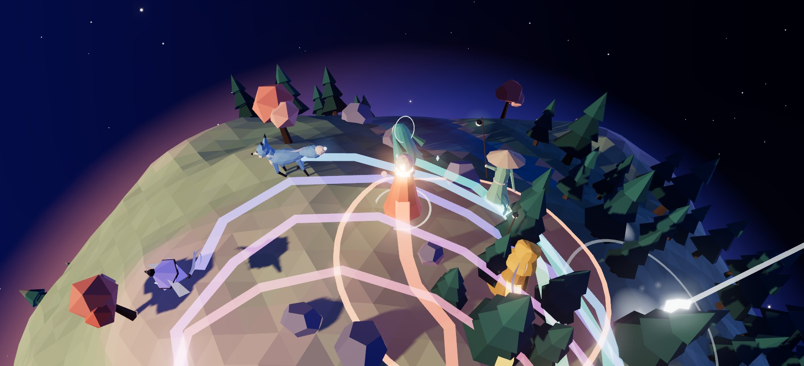
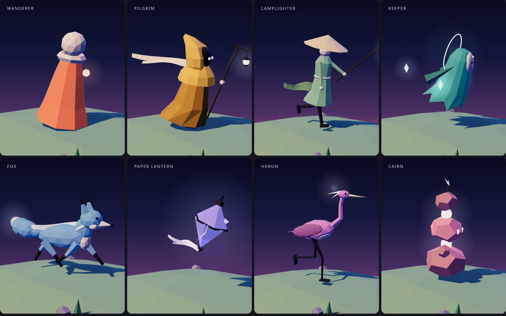
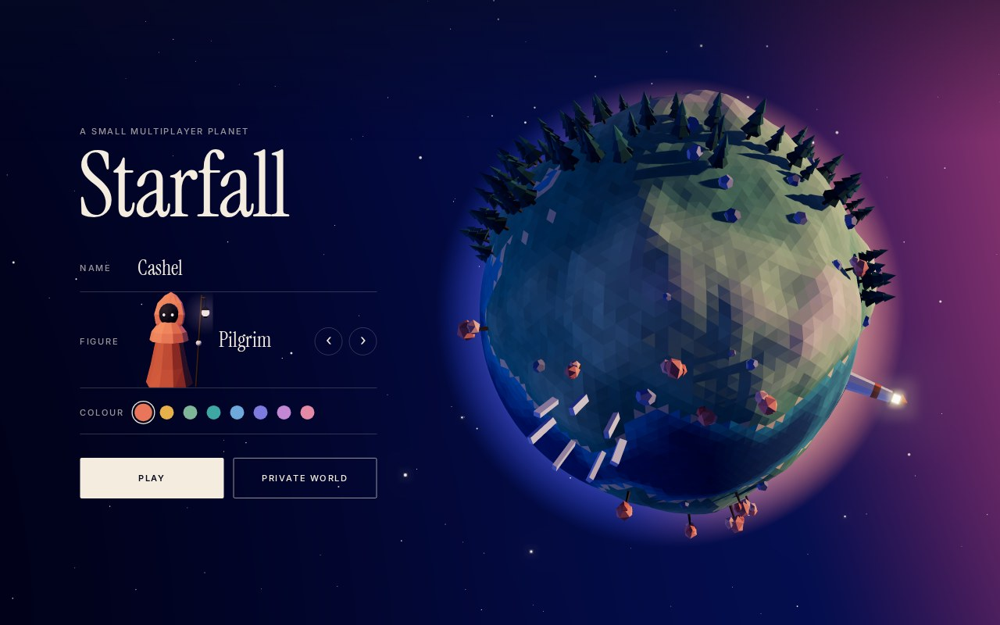

# Starfall

A small multiplayer game for the browser. Up to eight people run around a tiny
planet for sixty seconds, catching the stars that fall on it and keeping clear of
the meteors that follow. There are no accounts and nothing to install, and it plays
on phones and laptops.

**Play:** https://cashel.dev/starfall/



## How it plays

- A round lasts 60 seconds, followed by 9 seconds of results, and then the next
  round starts. This repeats for as long as anyone is in the world.
- A star is worth 1 point and a gold star 3. Run into one to catch it.
- A meteor shows a red ring on the ground about 2.6 seconds before it lands.
  Anyone inside the ring when it lands loses 2 points and is stunned for a moment.
- In the last 10 seconds stars fall much faster.
- The ribbon of light behind each player grows with their score.
- Players can "call out" (a ring of light and a note). It is the only way to talk.

| | Keyboard | Touch or mouse |
|---|---|---|
| Walk | WASD or arrow keys | Drag anywhere; the stick stays where you first touch |
| Call out | Space or E | The round button in the corner |

### Worlds

Everyone who presses **Play** lands in the same public world, part-way through
whatever round is running. A world holds eight people; when it is full a second
public world opens. **Private world** creates a world with its own link, and
anyone who opens the link joins it. There is no host and no start button: a world
is running from the moment its first player arrives and stops when its last one
leaves.

Two robots, Marvin and Trillian, keep a quiet world lively. They leave as people
arrive, so that there are always at least three players.

### Figures

Each player picks one of eight figures and one of eight colours on the start
screen. No two people in a world can share a figure or a colour: the start screen
is told immediately when one is taken, and if two people choose the same thing at
the same moment the server gives the later one the next spare.



The figures are built and animated entirely in code
([characters.js](characters.js)); there are no model or texture files.



## How it is built

```
index.html      the page: start screen, scoreboard, results
style.css       all styling
game.js         the client: planet, rendering, input, sound, networking
characters.js   the eight figures and their animation
shared.js       rules and constants used by both the client and the server
server/
  worker.js     the room server (Cloudflare Worker + Durable Object)
  wrangler.toml its configuration
```

### Client

The client is plain HTML, CSS and JavaScript modules with no build step.
[three.js](https://threejs.org) r160 is loaded from jsDelivr at a pinned version
through an import map.

- **The planet** is an icosphere displaced by seeded noise. Its trees, rocks,
  standing stones and lighthouse are placed from fixed seeds, so every player
  sees the same world without the server sending any of it.
- **Positions** are unit vectors from the planet's centre. Walking rotates that
  vector, and the camera's forward direction is carried along the surface with it.
- **The sunset** moves around the planet on a five-minute cycle taken from the
  server's clock, so everyone sees the same time of day.
- **Sound** is synthesised with the Web Audio API; there are no audio files.
- **Frame rate.** The game watches its own frame rate. A device that cannot keep
  up first renders at a lower resolution, then gives up the bloom, then the
  shadows. A device held at a steady 30 frames a second (a power saver, for
  example) is left alone, since lowering quality would not make it faster.

### Server

Each world is one [Durable Object](https://developers.cloudflare.com/durable-objects/)
on Cloudflare Workers. It runs on the free plan.

The server decides everything that has to be fair: rounds, where stars and
meteors fall, who caught what, and the scores. It ticks ten times a second. Each
browser reports its own position, which keeps movement instant for the player; the
server limits how far a position may move between reports.

Players talk to the room over a WebSocket, in JSON:

| Direction | Message | Meaning |
|---|---|---|
| client → server | `hi {name, c, ch}` | join with a name, colour and figure |
| | `p {d}` | my position, about twelve times a second while moving |
| | `c {id}` | I reached star `id` |
| | `e` | call out |
| | `ping {c}` | clock sync |
| server → client | `welcome {...}` | your id, the round, and everyone and everything in the world |
| | `join {p}`, `leave {id}` | a player arrived or left |
| | `look {id, ch}` | a robot changed figure to make way for a person |
| | `s {ps}` | positions of the players who moved |
| | `star {f}`, `got {id, by, s}` | a star fell; a star was caught |
| | `m {id, d, at}`, `hit {id, ps}` | a meteor is coming; it landed and struck these players |
| | `phase {phase, endsAt, round}` | a round started or ended |
| | `e {id}`, `pong {c, now}` | a player called out; clock sync |

The start screen opens a second kind of socket (`?watch`) that only receives the
list of colours and figures in use. These use the Durable Object hibernation API,
so people sitting on the start screen of an empty world cost nothing.

Guards against misuse: connections are only accepted from the game's own site,
each socket may send 60 messages a second of at most 300 characters, names are
reduced to 12 letters, digits and a few punctuation marks, and a player who sends
nothing for 90 seconds is let go. The server stores nothing; a world exists only
in memory while someone is in it.

## Running it yourself

You need Node.js for the server and any static file server for the client.

```bash
# the room server, on port 8791
cd server
npx wrangler dev --port 8791

# the client, in another terminal, from the repository root
python3 -m http.server 8000
```

Open http://localhost:8000. On any host other than the published site, the client
looks for the room server on port 8791 of whichever machine served the page.

To play from a phone on the same network, serve both on an address the phone can
reach, and tell the local server to accept any origin:

```bash
npx wrangler dev --port 8791 --ip 0.0.0.0 --var DEV_ANY_ORIGIN:1
python3 -m http.server 8000 --bind 0.0.0.0
```

`DEV_ANY_ORIGIN` only exists in that local command; the deployed server never sets it.

### Hosting your own copy

1. In `server/`, run `npx wrangler deploy`. It prints the Worker's address.
2. In [game.js](game.js), point `SERVER` at that address and change the hostname
   test above it to your site.
3. In [server/worker.js](server/worker.js), change `ORIGIN` to your site, then
   deploy again.
4. Put the files in the repository root on any static host.

### What the free plan allows

At the time of writing, Cloudflare's free plan allows 100,000 Durable Object
requests a day, with 20 WebSocket messages counted as one request, and 13,000
GB-seconds of running time. For this game that is roughly 45 hours of play a day
added up across all players, or about 28 hours of worlds being open. When a quota
runs out the game cannot be joined until it resets at midnight UTC; nothing is
charged.

## Credits

Made by [Cashel Fitzgerald](https://cashel.dev). Rendering by
[three.js](https://threejs.org); type is Instrument Serif and Inter.
